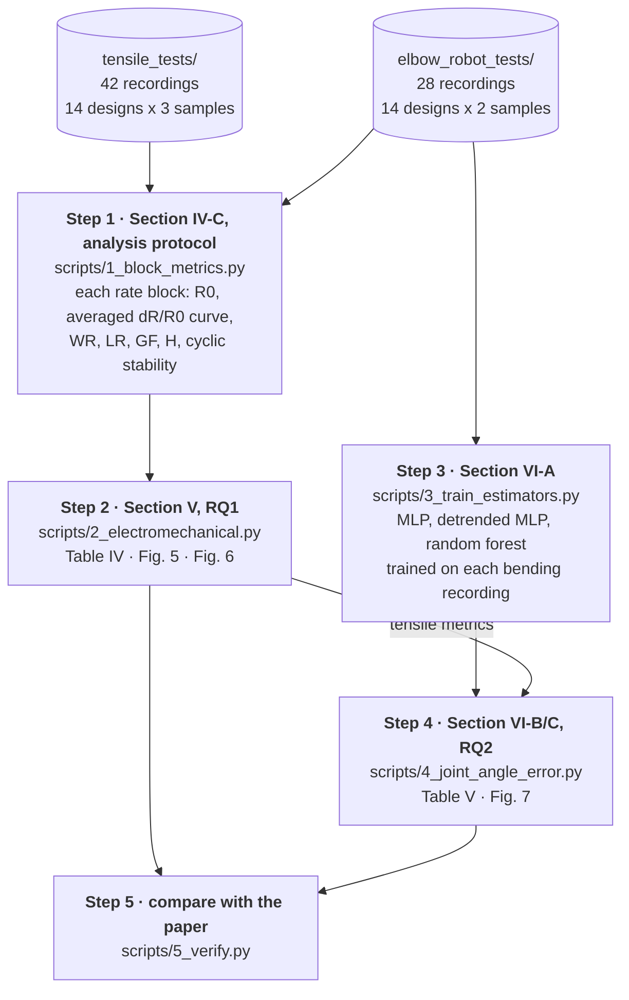
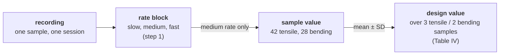

# Knitted strain sensors: knit structure, electromechanical metrics and joint-angle error

Analysis code of our paper on how knit structure shapes the electromechanical
metrics of knitted resistive strain sensors, and whether those metrics predict the
error of joint-angle estimation.

Starting from the raw recordings, the code regenerates every data result of the
paper: Tables IV and V, Figs. 5, 6 and 7, and every number quoted in the text. It
then checks them against the paper, number by number.

---

## The analysis at a glance

The paper asks two questions:

* **RQ1 (Section V):** how do knit structure and stitch size shape the
  electromechanical metrics?
* **RQ2 (Section VI):** do those metrics, measured in a tensile test, predict how
  well a sensor estimates a joint angle?

The code follows the same structure. Each script is one part of the paper:



| Step | Script | Paper | What it answers | Time |
|---|---|---|---|---|
| 0 | `0_check_data.py` | | Is `data/raw/` the data the paper used? | 10 s |
| 1 | `1_block_metrics.py` | IV-C, Table I | What are the metrics of each rate block of each recording? | 5 CPU-min |
| 2 | `2_electromechanical.py` | V | How do the metrics differ between designs, and do the two rigs agree? (RQ1) | 1 min |
| 3 | `3_train_estimators.py` | VI-A | How well does each recording estimate the joint angle? | 3 CPU-h |
| 4 | `4_joint_angle_error.py` | VI-B, VI-C | How large is the error, and which tensile metric predicts it? (RQ2) | 1 min |
| 5 | `5_verify.py` | | How do the regenerated numbers compare with the printed ones? | 5 s |

### From a recording to a design value

Every metric is aggregated through the same three levels:



* **Block.** Every recording contains three rate blocks: slow, medium and fast. The
  metrics are computed for each block.
* **Sample.** A sample is represented by its **medium-rate** block (paper Section
  IV-C). The other two rates appear only in the loading-rate paragraph of V-A.
* **Design.** A design is represented by the mean ± SD over its samples.

**The two bending samples of each design** are not alike:

* the **new** sample had never been tensile-tested;
* the **tensile-tested** sample had already been through the 5-hour tensile session.

**Tensile and bending results are compared in two pairings.** Both give 14 points,
one per design:

| Pairing | Tensile value | Bending value / error |
|---|---|---|
| **same-sample** | the tensile-tested sample | the same physical sample on the bending rig |
| **design-mean** | the mean of the 3 tensile samples of the design | the new sample |

Fig. 6 uses these pairings to compare the rigs. Fig. 7 uses them to correlate the
tensile metrics with the joint-angle error.

---

## 1. Setup (once)

```bash
conda env create -f environment.yml     # Python 3.10, numpy, scipy, scikit-learn, matplotlib
conda activate knit-sensors
```

`environment.yml` pins the versions the paper's numbers were produced with. Without
conda, use `pip install -r requirements.txt` in a Python 3.10 environment.

## 2. Input data

Take two folders from the project's shared drive (*textile knowledge base*) and put
them, or symbolic links to them, into `data/raw/`:

```
data/raw/
├── tensile_tests/
│   ├── Metadata.csv           one row per tensile session
│   └── data_raw/*.csv         one file per sample and session, e.g. C2_BCA_20260627_103757_port1.csv
└── elbow_robot_tests/         the bending tests
    ├── Metadata_elbow.csv
    └── data_raw/*.csv         e.g. C4_ACB_elbow_20260830_172713.csv
```

```bash
ln -s "/path/to/textile knowledge base/tensile_tests" data/raw/tensile_tests
ln -s "/path/to/elbow_robot_tests"                    data/raw/elbow_robot_tests
```

To keep the data elsewhere, edit the two paths at the top of
`knitsensor/config.py` instead.

* **The checksum list.** `data/manifest.csv` lists the 72 files the paper uses, with
  their checksums, and step 0 checks them. `Metadata.csv` must be the version of
  31 Aug 2026, which includes samples A4 and B4.
* **What is ignored.** Everything else in the folders: samples O-U, the one-week
  retests, `quick_figures/` and the measurement plans.
* **A1 and B1** are left out on purpose. They were run without the rest before the
  first reference block and were replaced by A4 and B4.

**Recording format.** Each recording has four columns and 100 rows per second;
there is no time column.

| Rig | Columns |
|---|---|
| tensile | `Segment, Cycle, Distance(mm), Port <n> resistance(ohm)` |
| bending | `Segment, Cycle, Angle(deg), Resistance_A<n>(ohm)` |

`Segment` numbers the protocol stages and `Cycle` counts the cycles inside a stage.
A resistance of −1 is an invalid reading.

**The 14 designs.** The first letter of a sample ID (`C2`, `I4`, ...) is its design
(`knitsensor/designs.py`).

| Letters | Structure | Stitch sizes |
|---|---|---|
| A, B | Plain jersey | A 10.5, B 11 |
| C, D | 1x1 rib | C 10, D 10.5 |
| E, F | Full cardigan | E 10, F 10.5 |
| G, H | Half cardigan | G 10, H 10.5 |
| J, I | 2x1 rib | **J 10, I 10.5**: here the letters run the other way |
| K, L | Conductive inlay | K 10.5, L 11 |
| M, N | Tuck rib | M 10, N 10.5 |

## 3. Running

Everything at once (on a laptop, about 1 hour with 4 workers):

```bash
bash run_all.sh                 # or: JOBS=8 bash run_all.sh
```

On Triton, run it as SLURM jobs. If your conda environment has another name, run
`export KNIT_ENV=<name>` first.

```bash
bash slurm/submit_parallel.sh     # fastest, about 10 min
sbatch slurm/run_all.sbatch       # simplest, one job of about 20 min
```

`submit_parallel.sh` submits three things:

* steps 0-2 as one job;
* step 3 split into 7 array jobs (`--part 0/7` ... `--part 6/7`), running at the
  same time as steps 0-2;
* steps 4-5 as one job, which starts only after all the others have finished.

The logs are `knit-*.out` files in the repository root.

To go step by step, run the scripts in order from the repository root. Each one
reads only what the previous steps wrote, so a step can be rerun on its own:

```bash
python scripts/0_check_data.py                # -> "72 of 72 input files are as expected"
python scripts/1_block_metrics.py --jobs 4
python scripts/2_electromechanical.py
python scripts/3_train_estimators.py --jobs 4
python scripts/4_joint_angle_error.py
python scripts/5_verify.py                    # -> results/verification_report.md
```

Step 3 is the only slow one. To try it on one recording first:
`python scripts/3_train_estimators.py --sample A5`.

## 4. What each step does

### Step 1: analysis protocol (Section IV-C), `knitsensor/blocks.py`, `knitsensor/metrics.py`

1. **Find the segments.** The `Segment` column splits a recording into rests,
   20-cycle references and rate blocks:
   * tensile: 200 preconditioning cycles, a reference, three 200-cycle blocks at
     3, 7 and 14.4 mm/s, and a reference;
   * bending: a reference, three 30-cycle blocks at 8.3, 18.5 and 39.5 °/s, and a
     reference.

   The rate of a block is recognised from its speed. The block order is in the file
   name, e.g. `BCA`.
2. **R₀ of each block** is the mean resistance over the last half of the rest
   before the block. The first block has no rest of its own and uses the nearest
   one: on the tensile rig the rest before the first reference, on the bending rig
   the rest after it.
3. **Cycles kept.** The first 50 of 200 tensile cycles and the first 10 of 30
   bending cycles are discarded.
4. **Averaged curve.** ΔR/R₀ of the kept cycles is averaged into one loading curve
   against strain, on a grid of 1/600 of the stroke (0.1 % strain). Bending angles
   are converted to strain with the robot calibration: 0→150° lengthens the sample
   by 61 mm, so strain = angle × 61 mm / 150° / L₀.
5. **Metrics of Table I** (`metrics.py`):
   * **WR:** the longest strain interval over which ΔR/R₀ rises by more than 0.002
     per window, where a window is 1/30 of the stroke.
   * **LR:** the longest interval inside the WR whose straight-line fit reaches
     R² ≥ 0.96.
   * **GF:** the slope of that fit.
   * **H:** the largest strain gap between loading and unloading at equal ΔR/R₀.
   * **Cyclic stability:** the SD of R across cycles at each point of the cycle,
     after removing a linear trend, averaged over the cycle.
6. **Settling** (tensile only, for the preconditioning paragraph of V-A): how much
   the per-cycle R₀ and GF still change from the first 50 to the last 50 cycles of
   each block.

### Step 2: electromechanical properties (Section V)

* **Table IV:** design mean ± SD of the six metrics on both rigs. The last row is
  the SD of the 14 design means divided by the median within-design SD: how much
  more the designs differ from each other than the samples of one design.
* **Fig. 5:** the averaged curves, tensile (mean ± SD of 3 samples) and bending
  (the new sample).
* **Fig. 6:** Spearman ρ between the tensile and the bending value of each metric,
  in both pairings, with a bootstrap 95 % interval over the 14 designs (10⁴ draws,
  seed 11).
* **The numbers quoted in V-A and V-B:** preconditioning, the stitch-size effect,
  the loading rate, the peak strain, the bending stroke, and so on.

### Step 3: joint-angle estimators (Section VI-A), `knitsensor/estimation.py`

1. **Windows.** Each rate block of a bending recording is cut into 0.25 s windows
   every 0.125 s. A window's target is its mean measured angle.
2. **Split.** In each block the first 80 % of the windows train and the last 20 %
   test. One model is trained per recording, on all three blocks.
3. **Input.** Each window is low-pass filtered at 20 Hz and z-scored with the
   statistics of the training windows.
4. **Estimators:**
   * an MLP (3 × 128, Adam 1e-4, early stopping);
   * the same MLP after subtracting a straight line fitted to the whole recording;
   * a random forest (200 trees, depth 20).

   All use `random_state` = 42.
5. **Two heads.** The regression ("reg", predict the angle) gives the paper's
   results. The 10° classification of the reference study ("cls") is only used for
   the comparison at the end of VI-C.

### Step 4: estimation error and RQ2 (Sections VI-B, VI-C)

* **Table V:** RMSE, MAE, R² and the share of windows within 5° for the new sample,
  plus the RMSE of the tensile-tested sample. The bracketed interval is a bootstrap
  over test windows (10⁴ draws, seed 42).
* **Fig. 7:** Spearman ρ between each tensile metric and the RMSE, for 3 estimators
  × 2 pairings, with a bootstrap 95 % interval over designs.
* **The numbers quoted in VI-B and VI-C:** among them the less-sensitive half of the
  designs and the classification-vs-regression comparison.

## 5. Outputs

| Paper | File |
|---|---|
| Table IV | `results/tables/table4_electromechanical.csv` and `.tex` (LaTeX rows, as in the paper) |
| Table V | `results/tables/table5_joint_angle.csv` and `.tex` |
| Fig. 5 | `results/figures/fig5_curves.pdf` |
| Fig. 6 | `results/figures/fig6_cross_rig.pdf`, data in `results/tables/fig6_cross_rig.csv` |
| Fig. 7 | `results/figures/fig7_rq2.pdf`, data in `results/tables/fig7_rq2.csv` |
| numbers in Section V | `results/numbers_section5.json`, grouped by subsection (`V-A`, `V-B`, ...) |
| numbers in Section VI | `results/numbers_section6.json` (`VI-B`, `VI-C`) |
| comparison with the paper | `results/verification_report.md` |

These tables are a good starting point for further analysis:

* `results/tables/samples_tensile.csv` (42 rows) and `samples_bending.csv`
  (28 rows): every metric of every sample at the medium rate.
* `results/tables/joint_angle_errors.csv`: the error of every recording, head and
  estimator.
* `results/blocks/`: the metrics of all three rate blocks.

The per-window predictions are in `results/predictions/<head>/<sample>.npz`. Each
estimator has the arrays `<estimator>_angle`, `<estimator>_pred` and
`<estimator>_rate`, with estimator one of `mlp`, `detr` or `rf`.

## 6. Comparison with the paper

`5_verify.py` puts the regenerated numbers next to the printed ones and lists
them in `results/verification_report.md`. It covers every cell of Tables IV and V,
the points of Figs. 6 and 7, and the numbers quoted in the text. The printed
values are in `reference/` (see `reference/README.md`).

## 7. Repository layout

```
├── README.md
├── run_all.sh                  runs steps 0-5
├── environment.yml             pinned versions (requirements.txt for pip)
├── slurm/                      the same on Triton: submit_parallel.sh (uses job.sbatch) or run_all.sbatch
├── data/
│   ├── manifest.csv            the 72 input files and their checksums
│   └── raw/                    the input data (not in git, see section 2)
├── scripts/                    the six steps, one per part of the paper
├── knitsensor/                 the functions the scripts use
│   ├── config.py               paths and protocol constants (rates, cycles, calibration)
│   ├── designs.py              the 14 designs
│   ├── data.py                 reading recordings and metadata, choosing the 42 + 28 recordings
│   ├── blocks.py               analysis protocol: recording -> rate blocks -> metrics   (IV-C)
│   ├── metrics.py              the metric definitions of Table I
│   ├── estimation.py           joint-angle estimators                                    (VI-A)
│   ├── stats.py                Spearman rho with bootstrap interval
│   ├── plotting.py             figure style
│   └── tables.py               reading and writing CSV / JSON
├── reference/                  what the paper printed (see reference/README.md)
└── results/                    everything the steps write (not in git)
```
